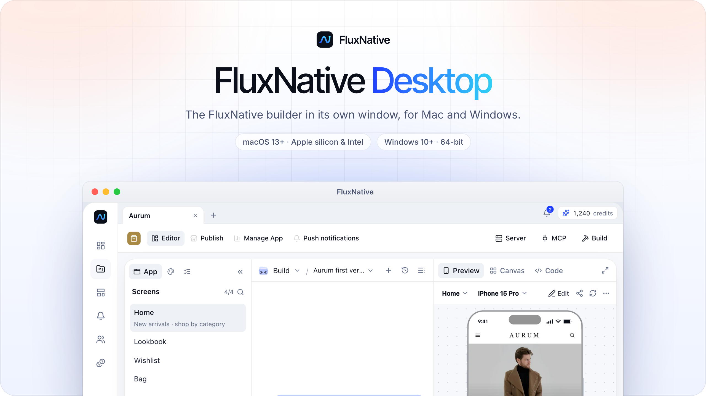
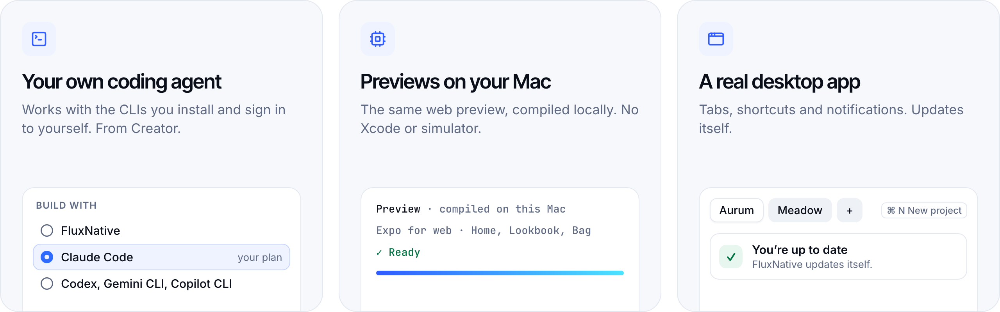

<a href="https://fluxnative.app/download">
  <picture>
    <source media="(prefers-color-scheme: dark)" srcset=".github/assets/banner-dark.png">
    
  </picture>
</a>

 

  
  &nbsp;
  <a href="https://github.com/fluxnative-app/fluxnative-desktop/releases/latest">
    <picture>
      <source media="(prefers-color-scheme: dark)" srcset=".github/assets/button-notes-dark.svg">
      
    </picture>
  </a>

<a href="https://fluxnative.app/download">fluxnative.app/download</a> picks the right installer for your computer.

 

<picture>
  <source media="(prefers-color-scheme: dark)" srcset=".github/assets/features-dark.png">
  
</picture>

## What the app adds

- **Your own coding agent.** From Creator. Works with the CLIs you install and sign in to yourself, such as Claude Code, Codex, Gemini CLI or Copilot CLI. Its provider bills its usage, not FluxNative.
- **Previews compiled on your Mac.** The same web preview, with no Xcode or simulator. The first one downloads about 1 GB. On Windows, previews compile on our servers, as in the browser.
- **A real desktop app.** Tabs, shortcuts and notifications. Installed copies update themselves.

## Installers

Every release has these files. Get the newest from [fluxnative.app/download](https://fluxnative.app/download) or the [latest release](https://github.com/fluxnative-app/fluxnative-desktop/releases/latest).

| Computer | Installer | Requires |
| --- | --- | --- |
| Mac with Apple silicon | `FluxNative-<version>-arm64.dmg` | macOS 13 or later |
| Mac with Intel Beta | `FluxNative-<version>-x64.dmg` | macOS 13 or later |
| Windows Beta | `FluxNative-Setup-<version>.exe` | Windows 10 or later, 64-bit |

> [!NOTE]
> The Windows installer is not code-signed yet. If SmartScreen asks, choose **More info**, then **Run anyway**.

## Install

- **Mac:** open the disk image and drag FluxNative to Applications.
- **Windows:** run the installer.

On a Mac, **FluxNative › About** shows the version and whether it is the Apple silicon or Intel build.

## About this repository

This repository holds release builds and their notes only. The app's source is not here.

  <a href="https://fluxnative.app"><b>Website</b></a>&nbsp;&nbsp;·&nbsp;&nbsp;
  <a href="https://fluxnative.app/docs"><b>Docs</b></a>&nbsp;&nbsp;·&nbsp;&nbsp;
  <a href="https://fluxnative.app/pricing"><b>Pricing</b></a>&nbsp;&nbsp;·&nbsp;&nbsp;
  <a href="https://x.com/fluxnativeapp"><b>X</b></a>

